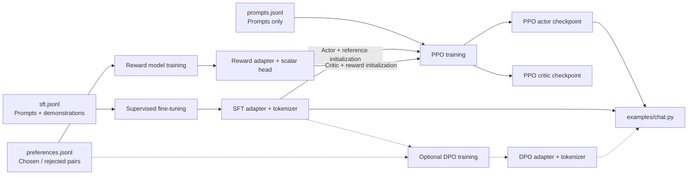
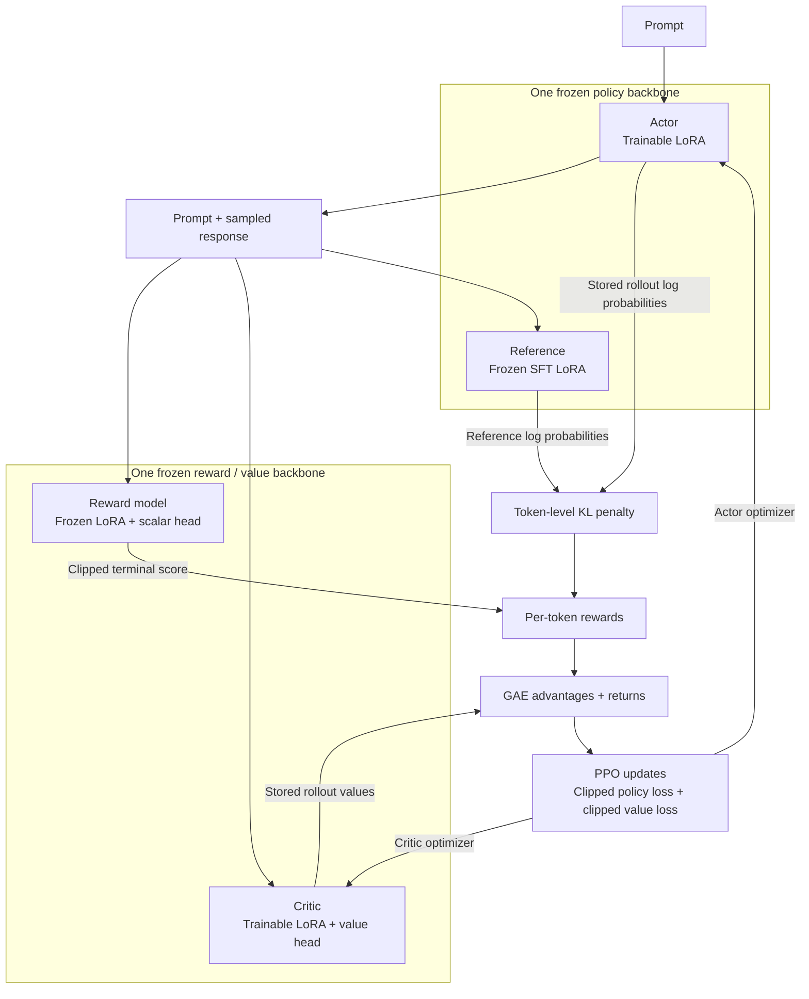

# Local RLHF

[English](README.md) | [简体中文](README.zh-CN.md)

A complete local RLHF training toolkit for Apple Silicon, featuring supervised fine-tuning, reward modeling, and PPO with memory-efficient LoRA.

Run the classic **SFT → Reward Model → PPO** pipeline on a Mac. Local RLHF uses PyTorch MPS, FP32, and LoRA, with CPU support for development and tests. The default configuration targets an **M1 Mac with 16GB unified memory** using **Qwen2.5-0.5B-Instruct**. DPO is also available as an optional training method.

## What is included

| Stage | Implementation |
| --- | --- |
| SFT | Causal language modeling with loss on response tokens only |
| Reward Model | Chosen/rejected preference pairs, a trainable scalar head, and pairwise logistic loss |
| PPO | Actor, frozen reference policy, frozen reward model, and an independently trained critic initialized from the reward model |
| PPO objectives | Token-level KL reward shaping, terminal reward, GAE, clipped policy loss, and clipped value loss |
| DPO | Preference optimization against a frozen snapshot of the starting policy |
| Inference | Interactive chat or one-shot generation from saved adapters |

The actor and reference share a frozen transformer base with separate adapters. The critic and reward model share another frozen base with separate adapters and heads. **Their trainable parameters remain independent.** This retains all four PPO roles while avoiding four full model copies.

## Data flow

The three datasets serve different purposes. SFT and reward checkpoints initialize PPO; the final actor is used for chat. DPO is an optional branch after SFT.



Checkpoints store adapters and tokenizer files, plus scalar-head weights where applicable. The frozen base model is loaded separately from the local/Hugging Face cache.

## PPO architecture and update loop

Each box below represents a model role, not a separate full model copy. The two groups share immutable base weights internally; actor and critic adapters are optimized independently.



Reference and reward parameters remain fixed throughout PPO. Each rollout group is reused for the configured PPO epochs before fresh responses are generated.

## Quick start

Use native **arm64 Python 3.11 or newer** on macOS with MPS support. The documented environment was tested with Python 3.11 and PyTorch 2.15.0.

```bash
git clone https://github.com/InfronAI/Local-RLHF.git
cd Local-RLHF
python3.11 -m venv .venv
source .venv/bin/activate
python -m pip install -e './applications/local-rlhf[test]'
local-rlhf doctor
```

Verify that `mps_available` is `true`. Then run all three classic stages:

```bash
cd applications/local-rlhf
python train_rlhf.py --device mps
```

The first run downloads the base model from Hugging Face. All training then happens locally. The bundled eight-example datasets demonstrate the pipeline; they are **not sufficient to produce a capable assistant or demonstrate a quality improvement**.

Once the model is cached, use `HF_HUB_OFFLINE=1 python train_rlhf.py --device mps` to avoid network metadata checks. Use a new output directory when rerunning training.

Chat with the trained actor:

```bash
local-rlhf chat --model output/local-rlhf/ppo/actor --device mps
# Or generate a single response:
local-rlhf chat --model output/local-rlhf/ppo/actor --prompt "What is LoRA?"
# Standalone example with the same options:
python examples/chat.py --model output/local-rlhf/ppo/actor --device mps
```

## Train each stage separately

Run these commands from `applications/local-rlhf` with the virtual environment activated:

```bash
local-rlhf sft --config configs/m1_16gb.json \
  --data data/sft.jsonl --output output/sft

local-rlhf reward --config configs/m1_16gb.json \
  --data data/preferences.jsonl --output output/reward

local-rlhf ppo --config configs/m1_16gb.json \
  --model output/sft --reward-model output/reward \
  --data data/prompts.jsonl --output output/ppo
```

Optional DPO after SFT:

```bash
local-rlhf dpo --config configs/m1_16gb.json \
  --model output/sft --data data/preferences.jsonl --output output/dpo
```

`python -m local_rlhf` is equivalent to `local-rlhf`. Explicit command-line options override JSON configuration values. Each output directory must be new or empty.

## Defaults for 16GB

| Setting | Default |
| --- | --- |
| Base model | `Qwen/Qwen2.5-0.5B-Instruct` |
| Device / precision | MPS when available / FP32 |
| LoRA rank / targets | 8 / attention `q_proj`, `v_proj` |
| Microbatch / accumulation | 1 / 8 |
| Maximum sequence / prompt / generation | 256 / 128 / 64 tokens |
| Activation checkpointing | Enabled |
| Training limit | 1 epoch, capped at 100 optimizer updates per stage |
| PPO updates per rollout group | 2 |

With eight bundled examples, these defaults perform one SFT update, one reward update, and two PPO updates. `--max-steps` is a cap, not a request to repeat the dataset. For longer runs, increase `--epochs` and supply appropriate training data.

For a smaller English model, use `--config configs/small.json` with `HuggingFaceTB/SmolLM2-135M-Instruct`. Memory depends on sequence lengths, model size, and other applications. If memory pressure rises, shorten sequences, reduce accumulation for PPO rollout storage, or use the smaller model. Do not disable the MPS memory safety limit.

## Test without downloading a model

```bash
# From the repository root:
pytest applications/local-rlhf/tests -q
python applications/local-rlhf/scripts/smoke_test.py \
  --device mps --output applications/local-rlhf/output/smoke
```

The smoke test creates a tiny random model locally and runs SFT, reward training, PPO, DPO, and saved-actor inference. Use `--device cpu` on machines without MPS. It validates execution and checkpoint compatibility, not language quality.

## Documentation

- [Training architecture and checkpoint behavior](applications/local-rlhf/docs/training.md)
- [Dataset formats and validation](applications/local-rlhf/docs/data.md)
- [Validation results and limitations](applications/local-rlhf/docs/validation.md)
- [CPU/MPS gradient comparison script](applications/local-rlhf/scripts/check_mps_gradients.py)
- [中文训练说明](applications/local-rlhf/docs/training.zh-CN.md)

All implementation code lives under `applications/local-rlhf`. Generated models, virtual environments, caches, and logs are excluded from Git.

## Origin and license

Local RLHF was rebuilt from the training workflow in [DeepSpeed-Chat](https://github.com/deepspeedai/DeepSpeedExamples/tree/master/applications/DeepSpeed-Chat). The original CUDA, DeepSpeed, distributed training, and unrelated example code has been removed. Local RLHF is an independent project and does not require the DeepSpeed runtime.

The new implementation uses the repository's [MIT license](LICENSE). The original upstream [Apache-2.0 license](LICENSE.upstream) and [attribution](NOTICE) are retained. Model weights have their own licenses; see the model cards for [Qwen2.5-0.5B-Instruct](https://huggingface.co/Qwen/Qwen2.5-0.5B-Instruct) and [SmolLM2-135M-Instruct](https://huggingface.co/HuggingFaceTB/SmolLM2-135M-Instruct).
