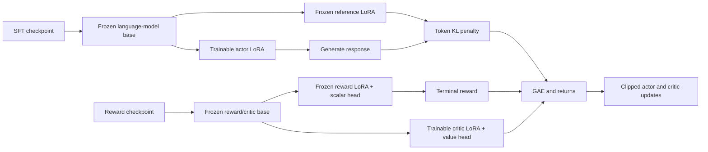

# Training architecture

[中文](training.zh-CN.md) | [Project README](../../../README.md)

## The classic three stages

1. **SFT:** freeze the pretrained transformer and train attention LoRA adapters. Tokenize each chat prompt with its chat template, mask prompt labels with `-100`, and optimize causal cross entropy on the final response plus EOS. Previous assistant turns are context, not training targets.
2. **Reward Model:** train a separate LoRA adapter and scalar head on chosen/rejected pairs. The last non-padding token (including EOS) produces each sequence score. The objective is `-logsigmoid(r(chosen) - r(rejected))`. The shared frozen LM output head is unused during reward/critic forward passes.
3. **PPO:** initialize the actor from SFT and the critic from the trained reward adapter and scalar head. Snapshot the actor adapter as the reference and snapshot the reward adapter/head as the fixed reward function. Generate on-policy responses, assign rewards, calculate GAE, and optimize the actor and critic separately.

The launcher starts each stage in a separate process to release model memory between stages. It runs SFT, reward training and PPO by default. DPO is a separate optional command.

## Four PPO roles, two frozen backbones



Only the immutable base parameters are shared within each pair. The reference adapter is a copy of the **trained SFT adapter**, not the unadapted pretrained model. Reward and critic start with equal adapters and scalar heads, then only the critic is optimized. Frozen adapters are excluded from optimizers and are not saved in final inference artifacts.

PPO uses one generated sequence at a time, with `gradient_accumulation_steps` determining the rollout group size. It then performs `ppo_epochs` updates on that fixed group before collecting fresh experience. Sampling uses temperature 1, top-p 1 and top-k 0 so stored log probabilities match the behavior policy. Dropout is disabled for consistent policy ratios.

For each response token:

```text
reward_t = -kl_coef * (old_actor_log_prob_t - reference_log_prob_t)
reward_last += clip(reward_model_score, -reward_clip, reward_clip)
delta_t = reward_t + gamma * old_value_(t+1) - old_value_t
advantage_t = delta_t + gamma * gae_lambda * advantage_(t+1)
return_t = advantage_t + old_value_t
ratio_t = exp(actor_log_prob_t - old_actor_log_prob_t)
```

EOS and the generation-length cap both terminate the finite rollout episode; terminal bootstrap value is zero. Advantages are normalized across response tokens in the group when their variance is nonzero. The policy uses the standard clipped surrogate. The value loss takes the maximum of unclipped and clipped squared errors, multiplied by 0.5. `value_loss_coef` scales the critic gradient. Actor and critic have separate AdamW optimizers and independently clipped gradient norms.

`sampled_kl` logs the old policy/reference log-probability difference on sampled tokens; a small negative sample mean is possible. It is held constant across PPO epochs on the same rollout group. A zero initial value is expected because actor and reference start equal. A near-zero initial normalized actor loss does not imply zero policy gradient.

## Memory and numerical choices

- FP32 supports the M1 target without relying on BF16 or mixed precision.
- LoRA trains `q_proj` and `v_proj`; the base weights stay frozen.
- Non-reentrant activation checkpointing reduces retained activations.
- Batch size 1 and short sequences bound activations and vocabulary logits.
- MPS uses standard PyTorch AdamW with `foreach=False`.
- PyTorch is pinned to 2.15.0 after real-model CPU/MPS gradient comparisons; see the [validation record](validation.md).
- No DeepSpeed, CUDA, NCCL, bitsandbytes, distributed workers or GPU offload engine is required.
- `PYTORCH_ENABLE_MPS_FALLBACK=1` is set before importing PyTorch; unsupported operations may execute on CPU. Set it in the environment yourself if embedding the package after PyTorch has already been imported.

The default input row cap is 10,000. `--max-samples 0` removes it, but all selected/tokenized rows are held in host memory. Large datasets should be prepared as bounded local subsets for this implementation.

## Configuration and checkpoints

CLI options override JSON config defaults. `epochs` controls dataset passes; `max_steps` caps optimizer updates. PPO counts each actor/critic update pair as one step. SFT weights microbatch losses by response-token count; preference training weights by pair count. This also handles partially filled final accumulation groups. PPO weights losses by the number of response tokens.

SFT, reward and DPO accept `--eval-data` for a separate held-out JSONL file. Validation loss and preference accuracy are logged after training. PPO logs rollout reward, sampled KL, actor/value losses, gradient norms and sampled memory statistics.

Every run writes `run.json`, `metrics.jsonl` and `summary.json`. SFT and DPO save the LoRA adapter and tokenizer in the output directory. Reward training also saves `reward_head.safetensors`. PPO saves `actor/` and `critic/`; use `actor/` for chat.

Artifacts contain adapters, not full base weights. The adapter records the base model identifier and the resolved Hugging Face revision when available. Keep the base model in the Hugging Face cache for offline use. For local base models, keep the original local base directory accessible.

Passing an existing adapter as `--model` continues from its weights with a **new optimizer**. This is not exact interrupted-run resume: optimizer state, RNG state, rollout buffers and scheduler state are not persisted. Output directories must be new or empty. Final checkpoints are written on successful completion; an interrupted run may leave only logs. There is no periodic checkpointing or learning-rate scheduler in this compact implementation.

For a longer run on your own datasets:

```bash
python train_rlhf.py --device mps --epochs 3 --max-steps 0 \
  --sft-data /path/to/sft.jsonl \
  --preference-data /path/to/preferences.jsonl \
  --prompt-data /path/to/prompts.jsonl \
  --output output/my-training
```

## References

- [PyTorch MPS backend](https://docs.pytorch.org/docs/stable/notes/mps.html)
- [PEFT model and adapter APIs](https://huggingface.co/docs/peft/v0.17.0/en/package_reference/peft_model)
- [Proximal Policy Optimization Algorithms](https://arxiv.org/abs/1707.06347)
- [Generalized Advantage Estimation](https://arxiv.org/abs/1506.02438)
- [Direct Preference Optimization](https://arxiv.org/abs/2305.18290)
